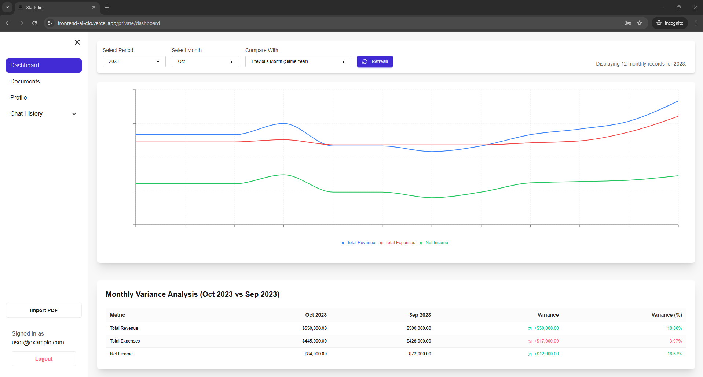
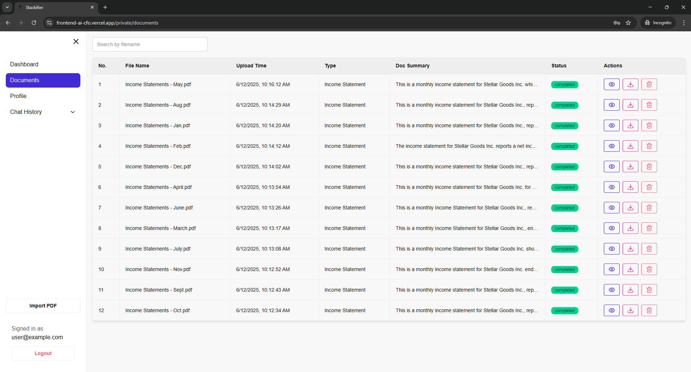
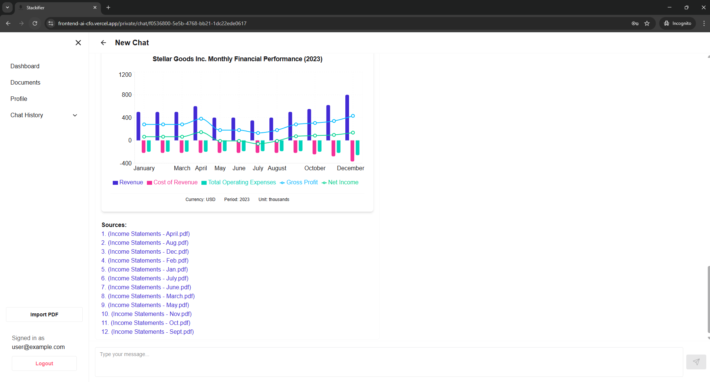
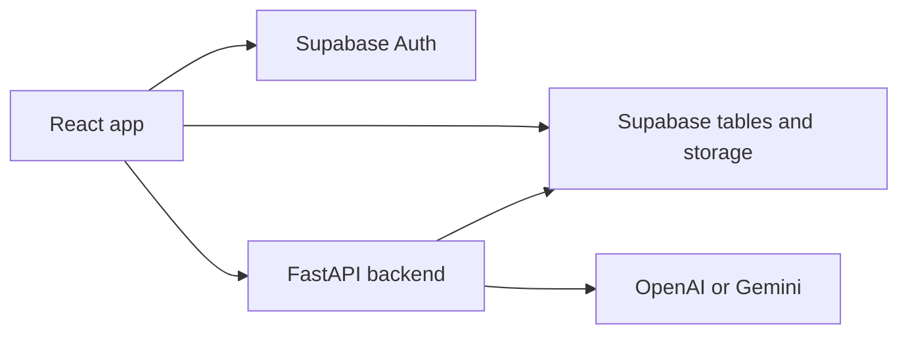

# StackRAG Frontend

React and TypeScript frontend for the StackRAG financial-document application.

The app connects to [StackRAG-Backend](https://github.com/BryanTheLai/StackRAG-Backend) for document processing and chat, and uses Supabase for authentication, storage, and chat-session data.

## Implemented flows

- email/password sign-up, sign-in, and sign-out
- authenticated routes for dashboard, documents, chat history, chat sessions, and profile
- PDF upload and processing-status display
- document list and PDF navigation
- chat responses streamed from the backend over server-sent events
- rendering of chart data and PDF-navigation markers returned by the chat workflow
- Supabase-backed chat-session history

## Screenshots







## Data flow



The browser gets a Supabase session, sends its access token to the backend, and uses the backend URL from `VITE_FASTAPI_BACKEND_URL` for document and chat requests.

## Stack

| Area | Technology |
| --- | --- |
| UI | React 19, TypeScript |
| Build | Vite 6 |
| Routing | wouter |
| Styling | Tailwind CSS, DaisyUI |
| Auth and data | `@supabase/supabase-js` |
| PDF | `react-pdf`, `pdfjs-dist` |
| Charts | Recharts |
| Markdown | `react-markdown`, remark plugins |

## Local setup

### Requirements

- Node.js 18 or newer
- npm
- a Supabase project
- a running StackRAG backend

### Install and run

```bash
git clone https://github.com/BryanTheLai/StackRAG-Frontend.git
cd StackRAG-Frontend
npm install
```

Create `.env.local`:

```env
VITE_SUPABASE_URL=https://your-project-ref.supabase.co
VITE_SUPABASE_ANON_KEY=your-anon-public-key
VITE_FASTAPI_BACKEND_URL=http://127.0.0.1:8000
```

Start the development server:

```bash
npm run dev
```

Open `http://localhost:5173`.

The optional `VITE_TEST_EMAIL` and `VITE_TEST_PASSWORD` values pre-fill the login form during local development. Vite exposes every `VITE_` variable to the browser, so do not place private keys in them.

## Routes

| Route | View |
| --- | --- |
| `/` | Home |
| `/login` | Sign in |
| `/signup` | Create account |
| `/private/dashboard` | Dashboard |
| `/private/documents` | Documents |
| `/private/chat/:id` | Chat session |
| `/private/chathistory` | Chat history |
| `/private/profile` | Profile |

## Repository layout

```text
src/
  components/      Shared UI and route guards
  config/          Backend URL and endpoint definitions
  contexts/        Authentication context
  pages/           Public and authenticated views
  supabase/        Auth, document, PDF, and chat-session access
  types/           Shared TypeScript types
  App.tsx          Route definitions
  main.tsx         Application entry point
public/            Screenshots and static assets
scripts/           Supabase SQL files shared with the backend
```

## Commands

```bash
npm run dev
npm run build
npm run lint
npm run preview
```

## License

MIT. See [LICENSE](LICENSE).
